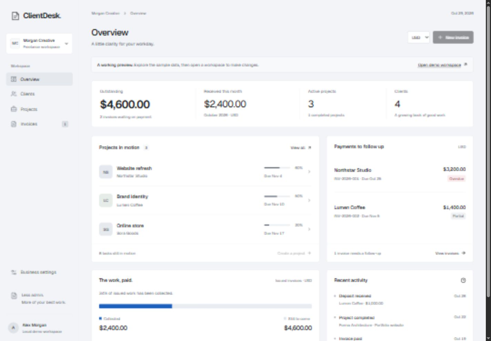

# ClientDesk
[](https://github.com/IliasJf/clientdesk/actions/workflows/ci.yml)

A freelancer workspace for clients, projects and invoices. Built with React 19, TypeScript, a shared domain layer and persistent SQLite storage in the local demo.

**[Try the live demo](https://iliasjf.github.io/clientdesk/)**: sample data, nothing to install. Changes stay in your browser.



## Run locally

Install Node.js 24 or newer. On Windows, double-click `Start-ClientDesk.cmd`, then visit **http://127.0.0.1:5174**. Or run:

```sh
npm ci
npm run preview:local
```

Click **Open demo workspace** to edit. This is a local development session, with fictional sample clients and invoices. It does not require a real account. Changes persist in `.sites-runtime/clientdesk.sqlite` across restarts. Keep this server on loopback; it is not a public production server.

## What works

- Overview with outstanding balances, monthly receipts, project progress and activity.
- Searchable clients, linked projects, editable business details and task checklists.
- Draft invoices with line items, discounts, tax, due dates and PDF export.
- Issue invoices to lock their details; record partial payments and track overdue balances.
- USD, EUR and MAD, reported separately without invented exchange rates.
- Responsive navigation, keyboard-accessible dialogs and clear save errors.
- Light and dark mode that follow the device setting; the invoice preview always stays on white paper.

Payments are manual records. The app does not charge cards or send email. Issued invoices keep seller and client snapshots, so changing a contact does not rewrite invoice history. Amounts use integer minor units, quantities use hundredths and line totals round half-up; discount is applied before tax. Duplicate payment requests are idempotent and overpayments are rejected.

## Architecture

`app/Desk.tsx` and `app/DeskForms.tsx` implement the interface. `lib/desk-domain.ts` owns validation, calculations and commands; both servers use this domain code. `lib/invoice-pdf.ts` lazily loads jsPDF, with multi-page line items. The built-in PDF font supports standard Latin text; complex-script font embedding is not included.

The local preview uses Node's built-in SQLite and an owner-scoped workspace document with an atomic revision check. The hosted adapter uses Drizzle and Cloudflare D1 with the same document model. Relationships are validated in the domain layer; this is not a normalized SQL schema. Revision checks prevent silent overwrites from competing tabs.

The hosted route uses server-provided Sites identity, same-origin JSON checks and bounded request bodies. Client-supplied owner IDs are rejected. Anonymous visitors receive read-only sample data.

## Checks

```sh
npm run typecheck
npm test
npm run build:preview
```

Twelve automated tests cover calculations, invoice locking, issue-time seller and client snapshots, reference validation, duplicate payments, stale writes, authentication, origin checks, persistence and PDF pagination. See [verification notes](docs/VERIFICATION.md) for the tested scope and limitations.

## Hosting status

The repository includes a Vinext/Cloudflare Worker adapter, D1 migration and Sites hosting manifest. The [GitHub Pages demo](https://iliasjf.github.io/clientdesk/) is a static build (`node scripts/build-demo.mjs`) that runs the same domain code in the browser and saves to localStorage. **The Worker and D1 version has not been deployed.** The production build encountered a Windows sandbox subprocess restriction (`spawn EPERM`); the publishing credential step was rejected by automatic approval review. The tested local preview uses a separate Rolldown build. Verify the Worker build and identity integration in a supported deployment environment before publishing.

`npm run dev` and `npm run build` target the Worker toolchain. They are separate from `preview:local`. The stored Sites project ID belongs to this creation session; create your own project before publishing a fork.

## Repository

Code is MIT licensed. Bundled Geist font retains its OFL license in `public/fonts/geist-OFL.txt`. Dependencies retain their own licenses. No credentials, local database or installed dependencies are included in the source archive.
